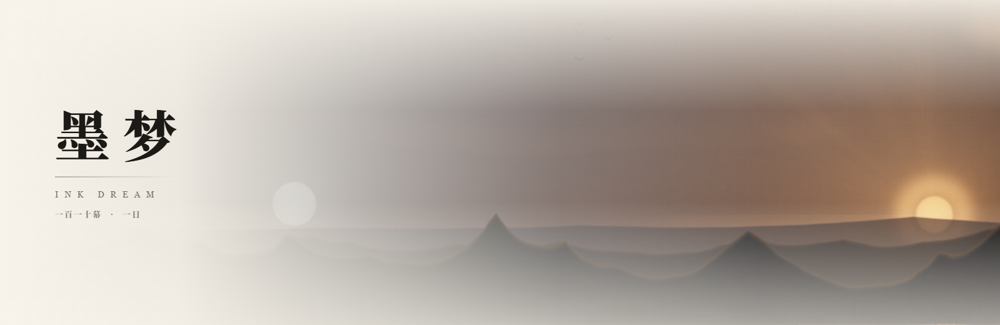
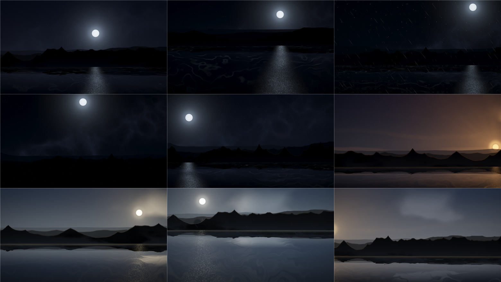

<picture>
  <source media="(prefers-color-scheme: dark)" srcset="assets/hero-dark.png">
  
</picture>

<br>

<div align="center">

**一滴墨落进水里，然后是一整天。**

<sub>`单文件 HTML` &#160;·&#160; `零依赖` &#160;·&#160; `零素材` &#160;·&#160; `6 分 34 秒` &#160;·&#160; `110 幕`</sub>

<br>

### [&#9654;&#160; 现在就看](https://daniei-chen.github.io/Ink-Dream/)

<sub>或下载 `index.html`，双击打开</sub>

</div>

<br>

---

<br>

<div align="center">
<sub>C H A P T E R S</sub>
</div>



<table>
<tr>
<td align="center" width="11.1%"><sub><b>一</b><br>夜起<br><i>Nightfall</i></sub></td>
<td align="center" width="11.1%"><sub><b>二</b><br>水深<br><i>Deep Water</i></sub></td>
<td align="center" width="11.1%"><sub><b>三</b><br>雾生<br><i>The Fog</i></sub></td>
<td align="center" width="11.1%"><sub><b>四</b><br>黑极<br><i>Utter Dark</i></sub></td>
<td align="center" width="11.1%"><sub><b>五</b><br>将晓<br><i>Before Dawn</i></sub></td>
<td align="center" width="11.1%"><sub><b>六</b><br>日出<br><i>Sunrise</i></sub></td>
<td align="center" width="11.1%"><sub><b>七</b><br>晨<br><i>Morning</i></sub></td>
<td align="center" width="11.1%"><sub><b>八</b><br>午<br><i>Noon</i></sub></td>
<td align="center" width="11.1%"><sub><b>九</b><br>暮归<br><i>Dusk</i></sub></td>
</tr>
</table>

<div align="center">
<sub>月出 &#8594; 中天 &#8594; 月落 &#8594; 日出 &#8594; 晨 &#8594; 午 &#8594; 暮</sub>
</div>

<br>

---

<br>

## 它不是循环播放的动画

大多数程序化风景是一段循环：镜头绕一圈，回到起点。

这里不是。**整部片子的时间是一条单向的曲线。**

`dayT` 从 `0.780` 走到 `1.756`，一次也不回头。太阳和月亮的位置是这个值的解析函数 —— 所以「月落」和「日出」不是两个镜头拼起来的，而是同一个连续过程的两端：

<div align="center">
<br>
<sub><i>月亮在西边沉下去的时候，太阳正从东边浮上来。</i></sub>
<br><br>
</div>

你不会看到它重新开始。因为它不重来。

<br>

## 山是固定的，动的是镜头

这是全片最要紧的一件事。

一百一十幕里，山没有变过。它就是同一片山。改变的是相机。

四层运动叠在一起：

| 层 | 作用 | 谁在动 |
|:---|:---|:---|
| **摇** &#160;`pan` | 整幅画面一起平移 | 天空、日月、星、云、雾、山、水 —— 全部 |
| **移** &#160;`dolly` | 带视差的横移 | 近山动满，中山一半，远山几乎不动 |
| **推拉** &#160;`zoom` | 焦距呼吸 | 两个互质周期叠加（250s / 69s） |
| **侧倾** &#160;`roll` | 不到 0.3° | 整个画幅，像手持 |

四个参数都是**几个互质周期的正弦叠加**。它们不会同时回到原点，所以构图永不重复 —— 但每一帧都连续。

<br>

## 一个片元着色器，画完所有东西

`index.html` 里没有一张图片，没有一个字体文件，没有一行外部请求。

字体是 base64 内嵌的 woff2。所有画面由一段 GLSL 跑出来：

```
天空渐变 → 星野 → 银河 → 月轮与月华 → 日轮与日晕
   → 云（丝云 / 积云 / 云海）
   → 远山 → 中山 → 近山
   → 雾 → 光柱 → 器物 → 水气
   → 水面（倒影 = 重新跑一遍场景，但抑制日月）
   → 暗角 → 纸纹 → filmic → gamma → S 曲线 → 颗粒 → 淡出
```

<br>

<details>
<summary><b>三个关键决定</b> &#160;<sub>（点击展开）</sub></summary>

<br>

**颜色全部在 sRGB 里传，进 shader 才转线性。**

早期版本直接在 gamma 空间做加法混色，结果所有中间调都偏灰偏脏 —— 山看起来像沙丘。

**水是场景的第二次渲染。**

水面不是贴图，是把 `sceneDry()` 用镜像坐标再跑一遍 —— 所以倒影里的山是真的山，月亮也真的在晃。日月盘在倒影里被单独抑制（`noOrb`），否则水面上会浮着一个白圆。

**大气透视用平方衰减。**

`haze * haze`，这样近山才真的黑得下去。实测近山 `#101217`（亮度 0.07），天空 `#72787E`（0.47）—— 对比 **1 : 6.7**。线性混合只有 1 : 2，那就是「单调」的来源。

</details>

<br>

## 声音是算出来的，不是录的

没有音频文件。全部由 Web Audio 实时合成。

<br>

**拨弦用 Karplus-Strong。**

一段噪声塞进环形延迟线，每绕一圈过一遍低通再衰减一次。泛音是这样一圈一圈掉下去的 —— 高频先走，留下木质的余韵。这是物理模型，不是采样，也不是振荡器叠加。

调式是 **D 羽五声**（D · F · G · A · C）。九章九句动机，每句四个音，循环时加一个延迟 0.46 秒的山谷回声，每八音落一个根音。

音区随章节走：夜在低音区，日出与晨抬一个八度，午后回落。

<br>

| 声音 | 做法 |
|:---|:---|
| **雨** | 白噪声过高通 620 Hz、低通 6.4 kHz，增益由画面里同一个 `rain` 变量推着走 |
| **鸟** | 只在白天、且雨量 < 0.45 时出现。**雨天不叫。** |
| **风** | 三个不同周期的正弦叠加，驱动芦苇摆幅、云的水平偏移、水面扰动 |

<div align="center">
<sub><i>雨里万籁俱寂，一声鸟鸣就破了。</i></sub>
</div>

<br>

## 关于那个人

全片有四幕，水边站着一个人。

他只有 **25 个像素高**。没有脸，没有五官，甚至没有头 —— 头顶直接是斗笠。

<br>

这不是偷懒。试过画完整的：圆头、锥形躯干、收起的腿。结果像一个雪人。

**人对形状极度敏感**，几十像素里拼几何体一定露馅。所以只留两笔：斗笠一横，身影一竖。边缘用噪声打散，墨不能齐边。

他不需要被看清。他只需要挡住水面上那条月光路 —— 那样你就知道他在那里了。

<br>

---

<br>

## 操作

| | |
|:---|:---|
| <kbd>Space</kbd> &#160;/&#160; <kbd>K</kbd> | 暂停 · 继续 |
| <kbd>&#8592;</kbd> &#160;<kbd>&#8594;</kbd> | 前后一幕 |
| <kbd>F</kbd> | 全屏 |
| 点击画面 | 暂停 · 继续 |
| 点进度条 | 跳转 |
| 右下角三条竖线 | 开关声音 |

<div align="center">
<sub>打开时会先静音。点一下画面，声音才起来 —— 这是浏览器的规矩，不是 bug。</sub>
</div>

<br>

## 本地运行

```bash
git clone https://github.com/daniei-chen/Ink-Dream.git
cd Ink-Dream
```

然后双击 `index.html`。

不需要 `npm install`，不需要构建，不需要本地服务器。

> **想用真曲子？** 把音频命名为 `bgm.mp3` 放在同目录，它会优先播放那个，合成音乐自动让位。

<br>

<details>
<summary><b>可调参数</b> &#160;<sub>（点击展开）</sub></summary>

<br>

URL 参数：

| 参数 | 作用 |
|:---|:---|
| `?t=240` | 从第 240 秒开始 |
| `?paused=1` | 载入即暂停 |
| `?shot=1` | 截图模式：跳过片头，强制显示章名 |
| `?bare=1` | 只留画面，去掉所有 UI |

源码里的关键位置：

| 名字 | 是什么 |
|:---|:---|
| `LIGHT` | 光照关键帧表 |
| `SHOTS` | 分镜：`S(时长, dayT, camX, 地平线, 变焦, 云, 雾, 水, 器物)` |
| `V` | 一百一十句诗文 |
| `MOTIF` | 九句旋律 |

</details>

<br>

## 浏览器

需要 WebGL。桌面 Chrome / Edge / Safari / Firefox 都行。

不支持时会给一张 CSS 渐变的静态底，不会白屏。

<br>

---

<br>

## 许可

| | |
|:---|:---|
| 代码 | [MIT](LICENSE) |
| 一百一十句诗文 | [CC BY-NC 4.0](https://creativecommons.org/licenses/by-nc/4.0/deed.zh) |

<div align="center">
<sub>代码随便用。诗别拿去卖。</sub>
</div>

<br>

---

<br>

<div align="center">
<sub>二〇二五 · 秋</sub>
<br><br>
<sub>我没有问 · 我坐下来 · 等下一次月出</sub>
</div>
